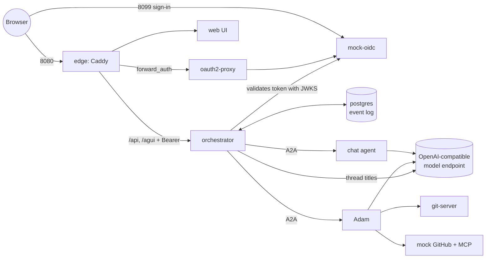

# another-agentic-local

A small, local Kubernetes setup for [another-agentic-system](https://github.com/vymalo/another-agentic-system): a chat in the browser, an orchestrator
written in Rust, and agents that do the work. It runs on **minikube** or **kind** with plain manifests: no Helm, no operators, no cert-manager, no ingress
controller, no TLS. It is for trying the system and developing against it, not for production.

> The production chart (`deploy/chart` in the system repo) expects Traefik, cert-manager, CloudNativePG, External Secrets and an https issuer.
> This repo replaces all of that with one throwaway Postgres, a mock sign-in and `kubectl port-forward`.

## What it deploys

Three variants, each building on the one before. Apply one; they share a namespace (`another-dev`).

| Variant | Adds | What you get |
|---|---|---|
| `base/` | Postgres, the orchestrator, the **chat** agent | The API and the AG-UI stream. You sign in with an OIDC bearer token from the issuer named in the config (see [Using a real issuer](#using-a-real-issuer-base)). No UI. |
| `web/` | a mock OpenID issuer, oauth2-proxy, a Caddy edge, the web UI | The chat in a browser at `http://127.0.0.1:8080`, signed in automatically as `dev@example.com`. |
| `coder/` | **Adam** (the coder agent), a git server, a mock GitHub, a mock GitHub MCP server | Ask Adam for a code change in a local repository: he clones, edits, runs the checks, pushes a branch and "opens" a pull request. |

| Pod | Image | Purpose | Idle memory |
|---|---|---|---|
| `another-agentic-db` | `postgres:17-alpine` | the event log (databases `orchestrator`, `agent`, `coder`); data is lost when the pod restarts | ~46 MiB |
| `another-agentic-orchestrator` | `ghcr.io/vymalo/another-agentic-system/orchestrator` | threads, delegation to agents, AG-UI and resource API | ~10 MiB |
| `another-agentic-chat` | adam image, `adam-agent` | a chat agent that is just a folder of Markdown | ~19 MiB |
| `mock-oidc` (`web/`) | built from the system repo | issues tokens for a few example users; approves anybody | ~20 MiB |
| `another-agentic-oauth2-proxy`, `-edge`, `-web` (`web/`) | oauth2-proxy, Caddy, the web's static export | sign-in and one origin for the UI and API | ~14 / 24 / 23 MiB |
| `coder` (`coder/`) | adam image, `adam-coder` | Adam | ~52 MiB after a task |
| `git-server`, `mock-github`, `mock-github-mcp` (`coder/`) | built; WireMock | what Adam talks to instead of GitHub | small |

The adam image is about 3 GB to download and 6.5 GB on disk. Memory figures were measured idle on minikube; the limits in the manifests are
copied from the production chart and were not tested under load.

### How it fits together



One message, in short: the client POSTs to the orchestrator's AG-UI route; the orchestrator writes the message to the Postgres event log and an outbox row in one
transaction; a dispatcher sends it to the agent over A2A; each frame the agent returns is appended to the log and streamed back as AG-UI events. Reconnecting replays
the log, which is why a thread made with curl is still there when you open the UI.

## Requirements

- Docker, `kubectl`, `make`, `curl`, `jq`, `openssl`, `git`
- **minikube** (tested, v1.38) **or kind** (see the note below)
- About 6 GB of free RAM for the cluster and 10 GB of disk (the adam image dominates)
- A bearer token for an **OpenAI-compatible model endpoint**. The manifests point at `https://api.ai.camer.digital/v1` with the models `deepseek-v4.1-flash` (chat) and
  `adorsys-coder` (Adam); change them with `sh scripts/configure.sh <base-url> <chat-model> <coder-model>`.
- x86-64. The adam image is `linux/amd64` only and runs slowly under emulation on Apple Silicon.

## Quick start on minikube

```sh
make cluster                       # minikube profile "another-dev": 6 CPUs, 5 GB
make images                        # builds mock-oidc and git-server from vymalo/another-agentic-system (pinned commit)
make load  VARIANT=coder           # pulls the big images into the node first (skip VARIANT=coder for base/web)
printf '%s' "$YOUR_MODEL_TOKEN" > model-api-key      # git-ignored
make secrets                       # namespace and Secrets; re-running keeps existing values
make deploy VARIANT=coder          # base | web | coder (coder includes web and base)
make restart                       # the orchestrator reads its config at startup
make forward                       # UI on http://127.0.0.1:8080, sign-in on :8099 (keep this running)
```

In another terminal: `make smoke CODER=1` (or `KUBE_CONTEXT=another-dev CODER=1 sh scripts/smoke.sh`). It checks readiness, that a request without a token is refused,
that the agents are listed, that a chat message streams to `RUN_FINISHED` with outcome `success`, and (with `CODER=1`) that Adam pushed a branch whose `hello.txt` says `hello`.

Open `http://127.0.0.1:8080`, pick **Adam** and ask:

> In http://git-server:8080/local/sandbox.git (base branch main), add a file hello.txt containing the single line hello. Run the checks and open a pull request.

The pull request is a canned answer from the mock GitHub; the branch and commit are real, in the local git server:

```sh
kubectl --context another-dev -n another-dev exec deploy/git-server -- sh -c \
  'cd /srv/git/local/sandbox.git && git for-each-ref refs/heads/agent && git log --oneline agent/* | head'
```

### Switching variants

Only one issuer is trusted at a time. `base/` trusts the live authz-idp named in its config; `web/` and `coder/` trust the mock issuer. After `make deploy VARIANT=…`
always `make restart`.

## Quick start on kind

```sh
make cluster CLUSTER=kind NAME=another-dev       # kind create cluster --name another-dev   (context: kind-another-dev)
make images
make load   CLUSTER=kind NAME=another-dev VARIANT=coder
make secrets CLUSTER=kind NAME=another-dev
make deploy  CLUSTER=kind NAME=another-dev VARIANT=coder
make restart CLUSTER=kind NAME=another-dev
make forward CLUSTER=kind NAME=another-dev
```

> **Not tested on kind.** Everything above was run on minikube. The kind path differs only in how images reach the node (`crictl pull` inside the node container
> and `kind load docker-image`, see `scripts/load-images.sh`) and in the context name (`kind-<name>`). The manifests use only core Kubernetes objects. If something
> differs, please open an issue.

## Using a real issuer (`base/`)

`base/` is set up for an OIDC issuer you do not run here: `auth.jwt.issuer: https://auth.ai.camer.digital` with audience `lightbridge-api-key`, the user from the `email`
claim and the role from the text claim `lightbridge_caller_kind` (an `api_key` role is defined). Edit `auth` in `base/orchestrator.yaml` for your issuer: `issuer`
(https, no trailing slash, exactly the token's `iss`), `audiences`, `userClaim`, `rolesClaim` and the `roles` that your tokens' role values map to.

```sh
make deploy VARIANT=base && make restart
kubectl --context another-dev -n another-dev port-forward svc/another-agentic-orchestrator 18080:8080 &
curl -s -H "Authorization: Bearer $TOKEN" http://127.0.0.1:18080/api/me
curl -sN -H "Authorization: Bearer $TOKEN" -H 'Content-Type: application/json' -H 'Accept: text/event-stream' \
  -d '{"threadId":"'$(uuidgen | tr A-F a-f)'","runId":"'$(uuidgen | tr A-F a-f)'","state":{},"tools":[],"context":[],
       "messages":[{"id":"'$(uuidgen | tr A-F a-f)'","role":"user","content":"Hello"}],"forwardedProps":{}}' \
  http://127.0.0.1:18080/agui/agents/chat
```

A browser sign-in against a real issuer needs an OAuth client registered there for the web UI; that is not covered by this repo.

## Configuration

| What | Where |
|---|---|
| Model endpoint and models | `scripts/configure.sh <base-url> <chat-model> <coder-model>` (edits `base/`, `web/patch-orchestrator-config.yaml`, `coder/coder.yaml`) |
| Model token and generated secrets | `scripts/secrets.sh` (Kubernetes Secrets only; nothing secret is in this repo) |
| Who can sign in (`web/`, `coder/`) | `web/users.json`, a ConfigMap read by the mock issuer; add your email to see your own threads |
| Orchestrator settings | `base/orchestrator.yaml` (`config.yaml`, `agents.yaml`); docs: `docs/api/config.md` in the system repo |
| Agents | `base/chat.yaml` (chat folder), `coder/agent/` and `coder/coder.yaml` (Adam), `coder/patch-orchestrator-agents.yaml` (the agent list) |

## Known limits

- The database is an `emptyDir`: threads are lost when the Postgres pod restarts. Artifacts and Adam's workspace are `emptyDir` too.
- The mock issuer approves anybody. Never expose these ports beyond `127.0.0.1`.
- Adam works against mocks: no real GitHub (no token or App), no mock CI as a second gate, no devcontainer or run pods. A real task needs the production setup of the
  adam-rs `deploy/coder` chart.
- No web search, browser agent, S3 artifact store, backups or network policies.
- If a first start hangs in `ContainerCreating`, run `make load` first: a kubelet pulls one image at a time and the 3 GB adam image blocks the rest.
- `minikube start` switches your default kubectl context; every command here passes `--context` explicitly.

## Layout

```
base/      postgres.yaml  orchestrator.yaml  chat.yaml  kustomization.yaml
web/       mock-oidc.yaml  oauth2-proxy.yaml  edge.yaml  web.yaml  Caddyfile  users.json  patch-orchestrator-config.yaml
coder/     coder.yaml  mocks.yaml  agent/  wiremock/  patch-orchestrator-agents.yaml
scripts/   secrets.sh  configure.sh  build-images.sh  load-images.sh  smoke.sh
Makefile
```

## Credits

The orchestrator, web UI, mock issuer and git server come from [vymalo/another-agentic-system](https://github.com/vymalo/another-agentic-system); Adam and the chat
agent from [vymalo/another-adam-rs](https://github.com/vymalo/another-adam-rs). The Caddyfile, the WireMock mappings and the coder's instructions are copied from
the system repo's `dev/` directory (commit `ce39839`). Check those repositories' licences before reusing these files.
